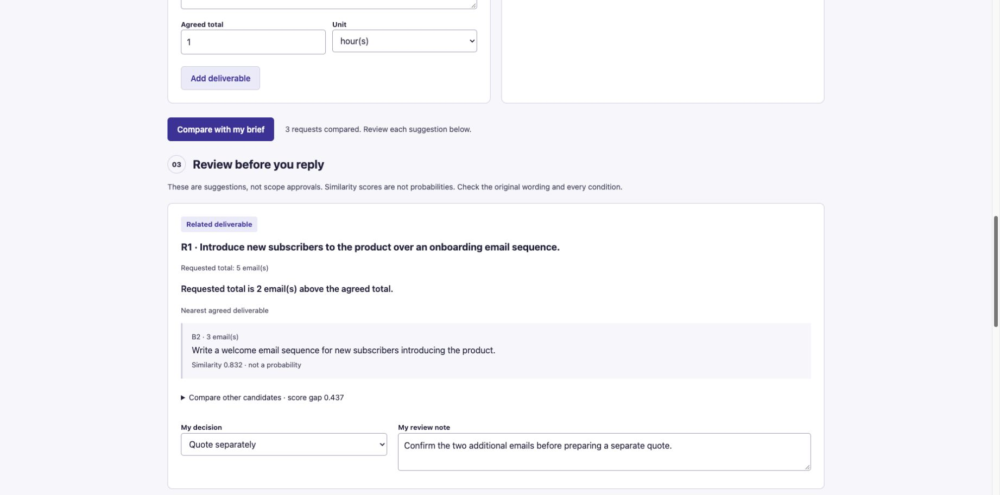

# Brief Ledger

Local scope review for independent English-language copywriters. Put agreed deliverables beside new client requests, inspect related source wording, compare manually entered total quantities, and record a decision before replying.



[Watch the 35-second screen-state walkthrough](docs/demo.mp4) (GitHub: **Download raw file**). It uses real screenshots, not a continuous recording. [Example review notes](docs/sample-review.md) show original evidence, a human decision, and unresolved rows.

## Run locally

Python 3.12 was used. From this directory:

```sh
python3.12 -m venv .venv
.venv/bin/python -m pip install -r requirements.lock
.venv/bin/python server.py
```

Open http://127.0.0.1:8798. The first start downloads the pinned model from Hugging Face; this requires internet. The cache defaults to `~/.cache/brief-ledger`. To choose another path, set `BRIEF_LEDGER_CACHE` before both online and offline starts. After the download:

```sh
HF_HUB_OFFLINE=1 TRANSFORMERS_OFFLINE=1 .venv/bin/python server.py
```

The app binds only to loopback. There is no hosted demo, account, API key or cloud inference. The page has no remote fonts, scripts or analytics. Input is processed in memory; neither server logging nor browser storage records it. Refreshing loses the workspace. Browser-managed form restoration and downloaded/copied files are outside that guarantee. Use **Prepare review notes**, then select/copy the text to keep it; an optional Markdown download is also available. Automated download completion was not verified in the development browser; the visible notes and generated bytes were inspected.

## Workflow

1. Enter one agreed deliverable per row. Include conditions and exclusions in the description. Enter its agreed total quantity and unit.
2. Split new requests into separate rows. Enter requested **total**, not extra quantity: five emails against three agreed means two more, not eight.
3. Compare. Inspect the nearest three source rows, their original wording, similarity and the gap between the first two scores.
4. Make your own decision: keep in agreed scope, quote separately, ask for clarification, or leave unresolved. Add a note and prepare the review text. Changing any input invalidates the review; changing a decision hides old prepared notes.

Nothing is automatically sent, priced, approved or rejected. This is a review worksheet, not legal interpretation or an autonomous quote writer. The model does not extract or reconcile quantities from prose. Counts are separate manual fields. One request can implicate multiple deliverables; nearest-row matching cannot resolve that relationship for you.

## Model and limits

[all-MiniLM-L6-v2](https://huggingface.co/sentence-transformers/all-MiniLM-L6-v2), revision `1110a243fdf4706b3f48f1d95db1a4f5529b4d41`, Apache-2.0, via [Sentence Transformers](https://www.sbert.net/). CPU inference, normalized 384-dimensional embeddings and cosine ranking. No custom remote model code or generation. Python standard-library HTTP server and a small vanilla HTML/CSS/JS interface.

A score below 0.40 is **No clear match**. Otherwise, a top-two gap below 0.08 is **Ambiguous match**. These are uncalibrated heuristics, not confidence probabilities. Quantity deltas are shown only for a clear related match with the same unit. Even then, a match is never proof the request is included.

English only. Up to 20 rows per side, descriptions of 3–500 characters, integer totals 1–1000. Inputs exceeding the model token limit are rejected rather than truncated. No PDF import, OCR, client history or cross-request quantity aggregation. It can miss paraphrases or confuse closely related work. The original brief always remains the reference.

## Actual validation

```sh
.venv/bin/python -m unittest discover -s tests -v
.venv/bin/python evaluate.py
```

Seven integration/behavior tests passed, including duplicate ambiguity, unrelated abstention, quantity changes, different units, original evidence, invalid input and HTTP origin/Host/path guards. The model was run from cache with offline environment flags.

[All 12 diagnostic cases and outputs](docs/evaluation.json) are included. Ten of twelve outcomes matched the author's intended match/abstention. Among ten related requests, eight were assigned to the intended source after the threshold; simple token Jaccard also ranked eight of ten first. This small set does **not** establish a general improvement over keyword matching. One intended landing-page request ranked email first but was marked ambiguous; another landed below the threshold and was left without a clear match. Those failures remain in the report. Warm median local analysis was 6.83 ms; first analysis 176.76 ms. Model loading is excluded. This is an author-written diagnostic, not an independent benchmark.

Browser checks covered the fictional example, decision entry, complete prepared review text, invalidation after decision changes, and a 375px viewport with no horizontal overflow (document width 360px). Screenshots are in `docs/`. No customer or willingness-to-pay test has been conducted.

## Who might pay, and why open source matters

The intended buyer is a freelance copywriter who repeatedly compares revision requests with a fixed brief. A plausible paid offering is a one-time local installation and workflow setup service around this MIT tool. That is a business hypothesis, not a validated price or sale. The current app is free; it has no billing or payment flow. A useful next test would be observing a consenting freelancer use it on a brief they choose, and learning whether the comparison saves enough time to justify setup support.

Open weights let matching run on a laptop after caching, with no per-request bill or client text sent to an inference provider. The code exposes the thresholds, original evidence and failures so a user can change the policy or replace the model. That makes a modest service with inspectable costs and behavior possible. Installation, model downloads and a capable laptop still have costs.

Started October 13, 2026 for [Hacktoberfest Week 2: Side Hustle](https://dev.to/challenges/hacktoberfest-week2-2026-10-12), within its entry period. This is a new project and repository; existing environment/model cache was reused, not the previous week's application. All example briefs, requests and diagnostic cases are fictional original material. No private client or employer data is included.

## License

MIT for this code and original sample content, copyright 2026 Renchao Wu. Model weights retain Apache-2.0. Dependencies retain their respective licenses; the frozen environment is listed in `requirements.lock`. Weights and dependencies are not vendored.
